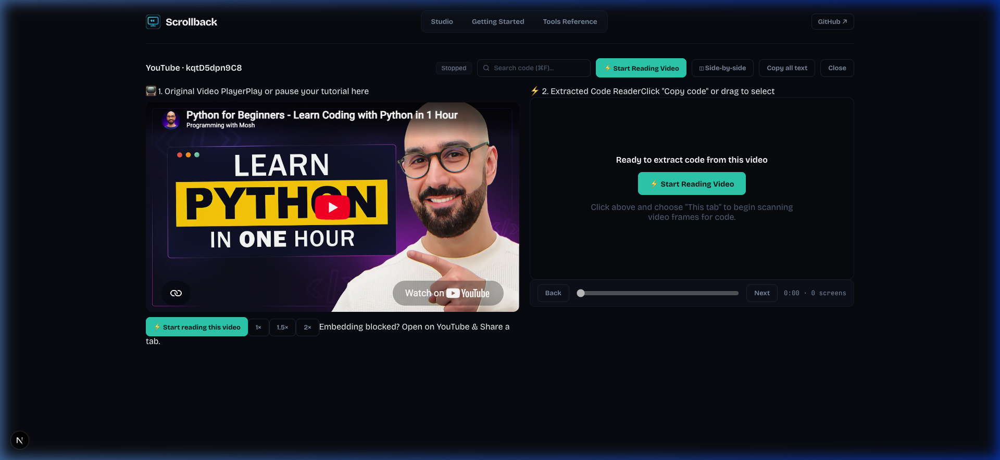
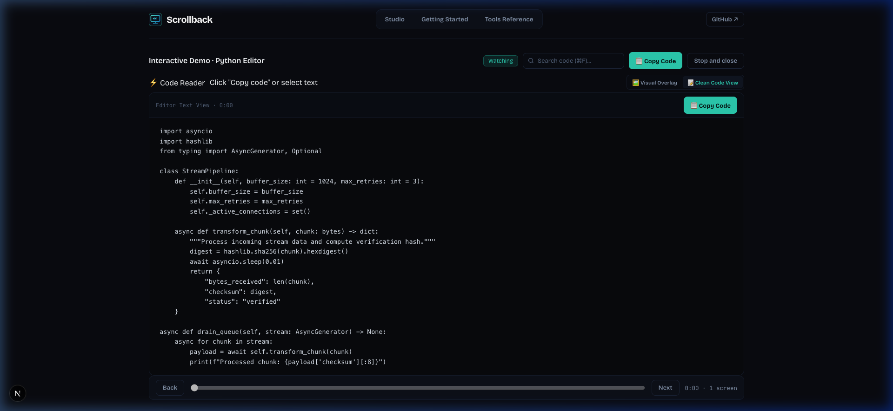

# Scrollback ⚡

> **Turn any screen video, live stream, or presentation into clean, selectable, searchable code.**

[](https://scrollback1.vercel.app/)
[](LICENSE)

🌐 **Live Demo:** [https://scrollback1.vercel.app/](https://scrollback1.vercel.app/)


Viewers open a link in their browser and can highlight, copy code blocks with preserved indentation, click links, and scrub backwards through video history while the presentation continues — then jump back to live.

---

## ⚡ What is Scrollback?

When watching technical video tutorials, live coding streams, or remote presentations, viewers often struggle to:
- Copy terminal commands or code snippets without typing them out manually.
- Pause and review earlier lines of code without interrupting the presenter or video playback.
- Search for specific variables, functions, or error messages across past video frames.

**Scrollback solves this directly in your browser:**
1. **Interactive Text Layer & Clean Code View**: OCR transcribes screen frames in real time with pixel-aligned text. Toggle between visual video overlays and a distraction-free dark code editor view with 1-click `Copy code`.
2. **Timeline & Historical Search (`⌘F`)**: Scrub through previous screens and search keywords across all captured frames.
3. **Multi-Source Capture**:
   - **Chrome Tab / Window**: Capture any browser tab or local app with change detection.
   - **YouTube Video**: Stream tutorials with synchronized code extraction and playback speed controls. *(🚧 In progress: YouTube Playlist button for multi-video series).*
   - **Video Files**: Drag-and-drop `.mp4` or `.webm` recordings for fast offline scanning.
   - **Mac CLI (`capture-mac`)**: Native ScreenCaptureKit streaming with Apple Vision OCR and end-to-end AES-256-GCM encryption.
4. **100% Private & Client-Side**: Browser OCR runs locally via Tesseract.js (WASM). No screen recordings or OCR text ever leave your computer.

| 📺 Side-by-Side YouTube Reader | 📝 Clean Code View (1-Click Copy) |
| :---: | :---: |
|  |  |

> 🚧 **Work in Progress:** We are currently working on a dedicated **YouTube Playlist** button and batch extraction engine to automatically scan, organize, and export code chapters across full multi-video tutorial series.

---

## 🏗️ Architecture

```
                      ┌────────────────────────────────────────┐
                      │            Browser Client              │
                      │  Next.js 16 + React 19 + Tesseract.js  │
                      └──────────────────┬─────────────────────┘
                                         │
        ┌────────────────────────────────┼────────────────────────────────┐
        ▼                                ▼                                ▼
  [Share Chrome Tab]              [YouTube Stream]              [Local Video File]
  MediaStream API +               No-cookie embed +             HTML5 Video +
  Canvas change detection         tab share crop                Local WASM OCR
                                         ▲
                                         │ (WebSocket encrypted frames)
                      ┌──────────────────┴─────────────────────┐
                      │              Relay Server              │
                      │  Node.js (dev) / Cloudflare Workers DO │
                      │  - In-memory circular buffer           │
                      │  - Automatic idle session cleanup      │
                      │  - Zero-knowledge encrypted relay      │
                      └──────────────────▲─────────────────────┘
                                         │
                      ┌──────────────────┴─────────────────────┐
                      │           Mac Native CLI               │
                      │  ScreenCaptureKit + Apple Vision OCR   │
                      │  AES-256-GCM Zero-Knowledge Encryption │
                      └────────────────────────────────────────┘
```

---

## 🚀 Quickstart

### Prerequisites
- Node.js 18+
- npm 9+

### 1. Web Studio (Browser App)
```bash
# Clone the repository
git clone https://github.com/dhvani7014/scrollback.git
cd scrollback/web

# Install dependencies and start development server
npm install
npm run dev
```
Open [http://localhost:3000](http://localhost:3000) to launch the Scrollback Studio.

### 2. Relay Server (Optional for Multi-user Presenter Streaming)
```bash
cd relay
npm install
npm run dev
```
Runs on `http://localhost:8787` with WebSocket endpoint `/ws/:sessionId`.

### 3. Mac Native Presenter CLI (macOS 13+)
```bash
cd capture-mac
./build.sh
./scrollback --relay http://localhost:8787
```
This prints a secure viewer link with an embedded decryption key in the `#fragment`:
```
Viewer link: http://localhost:8787/s/<session-id>#k=<encryption-key>
```
*Note: The encryption key exists only in the URL hash fragment and is never transmitted to the relay server.*

---

## 🧪 Testing

Scrollback includes comprehensive automated test suites covering unit logic, WebSocket relay protocols, session lifecycle, and browser OCR pipelines:

```bash
# 1. Run web unit tests
cd web && npm run test:unit

# 2. Run web production build validation
cd web && npm run build

# 3. Run relay protocol & security tests
node tools/relay_test.mjs http://localhost:8787

# 4. Run session memory & idle eviction lifecycle tests
node tools/session_lifecycle_test.mjs
```

---

## 🔒 Security & Privacy Model

- **Zero-Knowledge Architecture**: The Mac capture tool encrypts all screen frames using `AES-256-GCM` before sending them to the relay. The encryption key is appended only in the URL `#fragment`, ensuring neither the relay nor intermediate proxies can read the screen content.
- **Client-Side WASM OCR**: Browser tab sharing and video file processing execute completely inside client memory via WebAssembly. No video data or OCR text is sent to third-party APIs.
- **Presenter Token Enforcement**: Presenter WebSocket connections enforce cryptographic token checks (minimum 16 chars) to prevent unauthorized takeovers.
- **Automatic Resource Eviction**: Disconnected and idle relay sessions automatically clean up frame buffers after a 10-minute grace period to prevent memory leaks.

---

## 📚 Documentation

For in-depth guides, visit the documentation sections built into the web app:
- **Getting Started**: Quick tour of tab sharing, YouTube extraction, and Mac CLI.
- **Tools Reference**: Breakdown of OCR engines, change detection thresholds, and keyboard shortcuts (`⌘F`, `Arrow keys`).
- **Self-Hosting Guide**: Docker, Node.js systemd, and Cloudflare Workers deployment instructions.

---

## 📄 License

MIT License. See [LICENSE](LICENSE) for details.
